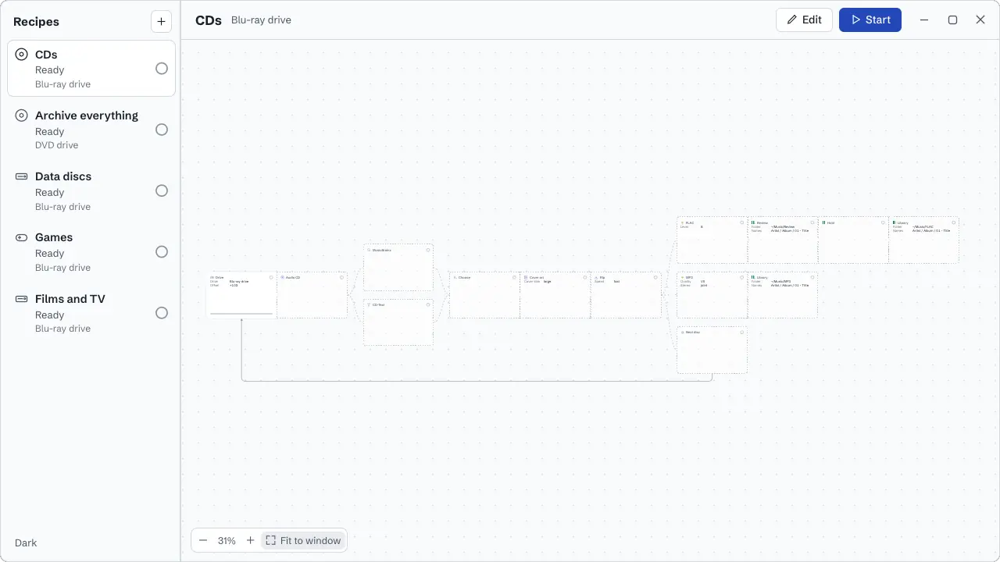
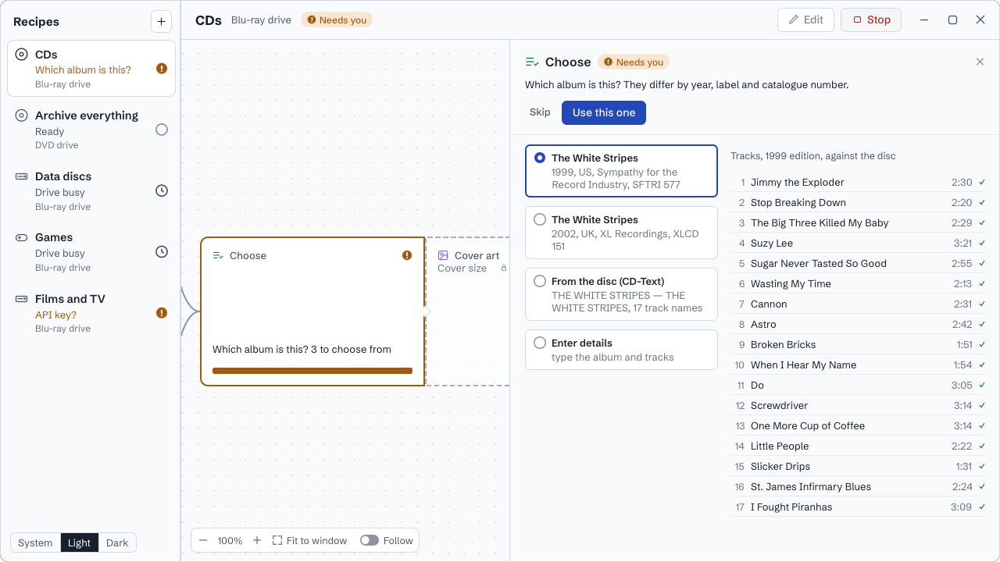
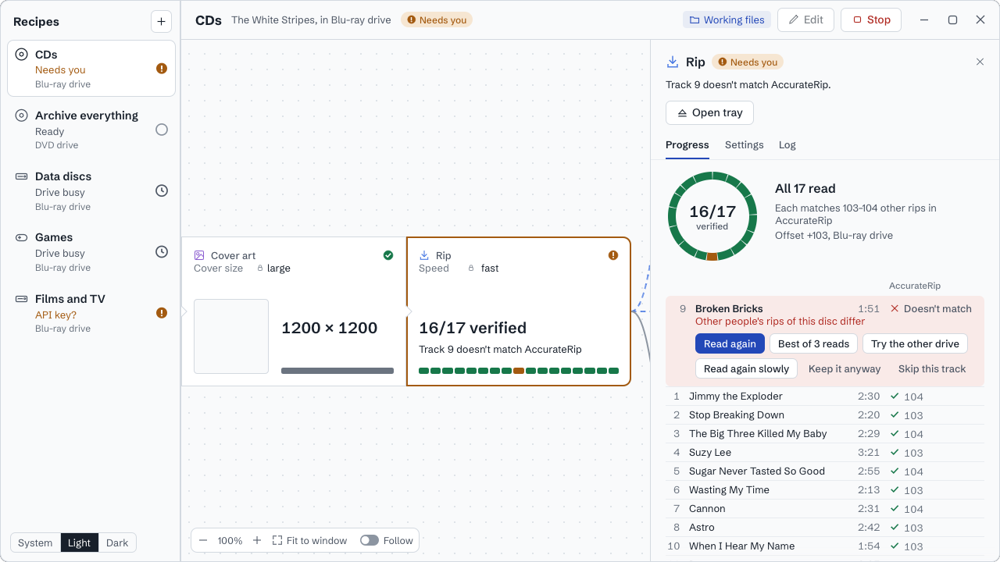
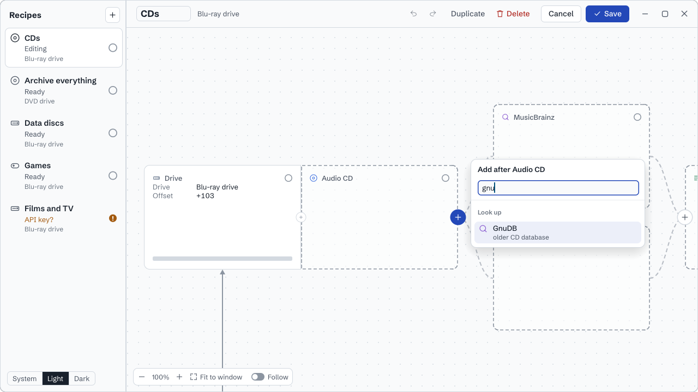
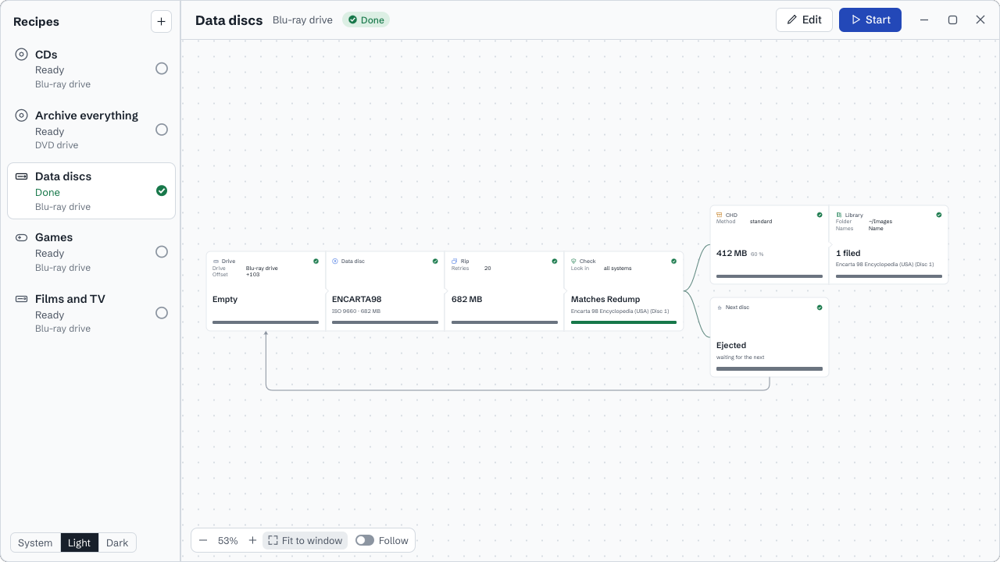

<div align="center">


# Disc Rip Trip

**Put a disc in, get properly named, checked files in your library.**

[](https://github.com/vresistor/disc-rip-trip/actions/workflows/build.yml)
[](LICENSE)

<picture>
  <source media="(prefers-color-scheme: dark)" srcset="docs/screenshots/rip-running-dark.png">
  
</picture>

</div>

Disc Rip Trip rips audio CDs, data discs, PlayStation games, DVDs and
Blu-rays. It looks up what the disc is, checks that what it read is
right, and files the results under the right names.

Each kind of disc goes through a **recipe**: a row of steps you can
watch while they run, and change.

## See it run



A simulated CD from start to the next disc.
[Watch it as a video (WebM)](docs/demo.webm).

## What it does

| Disc | Reads with | Finds out what it is from | You get |
|---|---|---|---|
| Audio CD | cyanrip, checked against AccurateRip | MusicBrainz, CD-Text, Discogs, GnuDB | each track in the formats you pick (FLAC, MP3, Opus, AAC, ALAC, Vorbis, WavPack, WAV), tagged, with cover art and lyrics, and the album's scans beside them if you like |
| Data disc | redumper | Redump, by checksum | a checked disc image, as a CHD or as a plain image |
| PlayStation game | redumper | Redump, by checksum, else by serial | a verified CHD named for the exact release, with its LibCrypt `.sbi` and a `.m3u` for multi-disc games |
| DVD, Blu-ray | MakeMKV | TMDb | films and episodes, converted to H.265 or AV1 or kept as they are, named the way Jellyfin likes |

Audio is checked track by track. If AccurateRip doesn't confirm a
track, it's read again carefully. If the reads still don't agree, the
track waits for you, with *Read again*, *Best of 3 reads*, *Read again
slowly*, *Keep it anyway* and *Skip this track*. The rules are in
[`docs/audio-accuracy.md`](docs/audio-accuracy.md).

## How a recipe works

- **A recipe is a row of steps**, read left to right: the drive, what
  kind of disc it is, the lookups, *Choose*, *Rip*, the encoders, the
  folders.
- **Every step shows how it's doing** while the disc goes through:
  *6 of 17*, *Which album is this?*, *2 encoding*.
- **Click a step to see it in the sidebar:** what it did, its settings,
  and its log. There's no separate settings page.
- **It only asks when it has to.** Choose picks the album itself when
  the disc ID matches. When it isn't sure, it asks, with the best match
  already picked.
- **Add a step with +.** It only offers steps that fit there, so you
  can't end up with a recipe that doesn't work.
- **Next disc** opens the tray and starts again, while the last disc is
  still encoding.
- **Hold** keeps files in a review folder until you let them through.
- **Notify** tells you how the disc went, on your desktop or your phone
  (through ntfy).

<table>
<tr>
<td width="50%"><picture><source media="(prefers-color-scheme: dark)" srcset="docs/screenshots/choose-dark.png"></picture><br><sub>Choose asks only when it isn't sure.</sub></td>
<td width="50%"><picture><source media="(prefers-color-scheme: dark)" srcset="docs/screenshots/rip-sidebar-dark.png"></picture><br><sub>A track that doesn't match waits for you.</sub></td>
</tr>
<tr>
<td><picture><source media="(prefers-color-scheme: dark)" srcset="docs/screenshots/edit-picker-dark.png"></picture><br><sub>Editing: + offers only what fits.</sub></td>
<td><picture><source media="(prefers-color-scheme: dark)" srcset="docs/screenshots/data-dark.png"></picture><br><sub>A data disc: ripped, checked, CHD, filed.</sub></td>
</tr>
<tr>
<td><picture><source media="(prefers-color-scheme: dark)" srcset="docs/screenshots/games-dark.png"></picture><br><sub>A PlayStation game, checked against Redump.</sub></td>
<td><picture><source media="(prefers-color-scheme: dark)" srcset="docs/screenshots/video-dark.png"></picture><br><sub>A film, found on TMDb and filed for Jellyfin.</sub></td>
</tr>
</table>

The built-in recipes are *CDs*, *Data discs*, *Games*, *Films and TV*,
and *Archive everything* (four lookups and four outputs, to show what
a recipe can do). You can change any of them, and *Reset to original*
puts one back.

## Getting it

Linux, x86_64. Two ways:

- **The flatpak.** Download `disc-rip-trip-*.flatpak` from
  [Releases](https://github.com/vresistor/disc-rip-trip/releases), then
  `flatpak install --user ./disc-rip-trip-*.flatpak`. It brings cyanrip,
  redumper, ffmpeg and ffprobe with it.
- **From source**, below. Then you install the tools yourself.

Either way, DVDs and Blu-rays need [MakeMKV](https://www.makemkv.com),
which is never bundled: the Flathub flatpak `com.makemkv.MakeMKV`, or
makemkv.com.

**What the flatpak can reach.** It needs the disc drive itself, so it
has access to all devices. It can see your whole filesystem, so a
library can be on a NAS mount, an external drive or anywhere you type.
To run MakeMKV, which lives outside it, it's allowed to start programs
on your computer. Together that means the sandbox doesn't wall it off
from the rest of your system; treat it like any program you install.

## Building from source

You need:

- Rust 1.89 or newer ([rustup](https://rustup.rs)),
- a C and C++20 compiler (`gcc-c++` on Fedora, `build-essential` on
  Ubuntu), for the built-in CHD library,
- a graphics driver with Vulkan or OpenGL. Mesa's is fine.

```sh
git clone https://github.com/vresistor/disc-rip-trip
cd disc-rip-trip
cargo build --release -p drt-app -p drt   # target/release/disc-rip-trip and drt
cargo run --release --bin disc-rip-trip -- --simulate  # fake drives and discs, to try it out
```

`--simulate` makes up two drives and a disc of every kind. It doesn't
touch your drives, the network or your files, and it keeps its own
recipes and settings apart from your real ones.

With real drives, the built-in recipes start out pointing at the
simulated ones, so they say *Not connected*. Click each recipe's Drive
step and pick your drive.

There's also `drt`, which runs a recipe in the terminal:

```sh
cargo run --bin drt -- --simulate                           # the CDs recipe, simulated
cargo run --bin drt -- --recipe archive --simulate --bad 9  # track 9 fails to verify
cargo run --bin drt -- --help
```

Tests: `cargo test --workspace`. The window tests save a picture of
every state they reach to `app/shots/`.

To build the flatpak yourself: `scripts/build-flatpak.sh` (add
`--install` to install it). It compiles everything inside the GNOME
SDK, fetching the SDK and the tools the first time.

## Tools to install

Built from source, the app runs these programs. It looks for each one
on your `PATH`, or you can point at it with `DRT_<NAME>`, for example
`DRT_CYANRIP=/opt/cyanrip/bin/cyanrip`. If one is missing, the window
says so at the top. The flatpak has all of them but MakeMKV.

| Tool | Needed for | Getting it |
|---|---|---|
| [cyanrip](https://github.com/cyanreg/cyanrip) | audio CDs, and measuring a drive's offset | Not in Fedora. Ubuntu 24.04 has 0.9.2; the app is tested with 0.9.3. Otherwise build it: `scripts/build-cyanrip.sh <folder>`. |
| [redumper](https://github.com/superg/redumper) | data discs and games | Download a build from its releases page. |
| [ffmpeg](https://ffmpeg.org) and ffprobe | every encoder, ReplayGain, converting and remuxing video | From your distro, with the encoders the recipes use (LAME, Opus, Vorbis, x265, SVT-AV1). Fedora's `ffmpeg-free` has no x265, so use RPM Fusion's. |
| [MakeMKV](https://www.makemkv.com) | DVDs and Blu-rays | The Flathub flatpak `com.makemkv.MakeMKV`, or makemkv.com. The app never bundles it. |

CHD files are made by MAME's CHD library, built into the app
([libchdman-rs](https://crates.io/crates/libchdman-rs)), so there's no
`chdman` to install.

## Online services

Most need no account. Keys and tokens are set once, in the step that
uses them, and every recipe shares them.

| Service | Used for | Key |
|---|---|---|
| [MusicBrainz](https://musicbrainz.org) | releases, by disc ID, and the other editions of the album chosen | none |
| [Cover Art Archive](https://coverartarchive.org) | the chosen release's cover (or a bigger one from another edition of the album), and its scans for Artwork files | none |
| [LRCLIB](https://lrclib.net) | lyrics, synced when it has them | none |
| [Discogs](https://www.discogs.com) | releases, by barcode, catalogue number, or artist and album | a personal access token (Discogs: Settings, Developers). Without one, the step is skipped. |
| [GnuDB](https://gnudb.org) | releases, by CDDB ID | your email address, which GnuDB asks for. Without one, the step is skipped. |
| [AccurateRip](http://www.accuraterip.com) | checking each track, and the list of drive offsets | none |
| [Redump](http://redump.org) | checking data discs and games | none. Its lists are kept for two weeks. Redump has no HTTPS, so they arrive unencrypted; at worst a changed list misnames a game, and each disc is still checked against its own checksums. |
| [TMDb](https://www.themoviedb.org/settings/api) | films and series | a free API key. *Films and TV* can't start without one. |
| [ntfy](https://ntfy.sh) | Notify, on your phone | a topic name you choose. Uses `https://ntfy.sh` unless you set your own server. |

## Where things are kept

| What | Where |
|---|---|
| Recipes and settings | `~/.config/disc-rip-trip/` (`recipes.json`, `settings.json`). `--simulate` uses a `simulate/` folder inside it. |
| A run's working files | `~/.cache/disc-rip-trip/runs/`. Deleted when a run finishes cleanly; kept if it was stopped or something failed. |
| Downloaded lists (drive offsets, Redump) | `~/.cache/disc-rip-trip/cache/` |

These follow `$XDG_CONFIG_HOME` and `$XDG_CACHE_HOME` if you set them.
The flatpak keeps them inside `~/.var/app/io.github.vresistor.DiscRipTrip/`
(`config/disc-rip-trip/`, `cache/disc-rip-trip/`). The first time it
starts, if it has no recipes yet, it copies `recipes.json` and
`settings.json` from `~/.config/disc-rip-trip/`, so a build from source
and the flatpak start out the same.

If `recipes.json` or `settings.json` can't be read, the app never
overwrites it. It uses the built-in recipes and leaves your file alone.

## Getting a disc out

While a disc is being read, Linux locks the drive's door, so the drive's
own eject button does nothing. Use **Open tray** instead: it's on the
Drive step's sidebar, and on Rip's while it reads. It stops the read
(the track waits for you, and nothing from the half-finished read is
kept), unlocks the door and opens the tray. Put the disc back and choose
**Read again** to go on.

If you'd rather the drive's button always worked, you can tell Linux not
to lock the door (needs root, and lasts until the next restart):

```sh
sudo sysctl dev.cdrom.lock=0
```

To keep it, put `dev.cdrom.lock = 0` in a file in `/etc/sysctl.d/`. The
catch: the button then pulls the disc out mid-read, without warning. The
read fails and that track waits for you, but nothing stops the press.

## Status

- Every recipe runs. The CDs recipe has ripped real discs end to end.
- Data discs, games and video are built and tested on simulated discs,
  but not yet on real ones.
- Linux only. It doesn't build on Windows yet (running the tools needs a
  Unix pseudo-terminal), and on macOS it wouldn't find any drives. So
  there are no Windows or macOS downloads.

## More

- [`DESIGN-UX.md`](DESIGN-UX.md): how it's designed. Recipes, steps,
  what can follow what, the window.
- [`GLOSSARY.md`](GLOSSARY.md): the words it uses, and the ones it
  avoids.
- [`docs/audio-accuracy.md`](docs/audio-accuracy.md): offsets, reads
  and how each track is checked.
- [`docs/portability.md`](docs/portability.md): what it would take to
  run elsewhere.
- [`docs/adr/`](docs/adr/): decisions, and why.

## Licence

GPL-3.0-or-later. See [`LICENSE`](LICENSE).
[`THIRD-PARTY.md`](THIRD-PARTY.md) lists what a release bundles, under
which terms, and where its source is. MakeMKV is never bundled; that
file says why.
