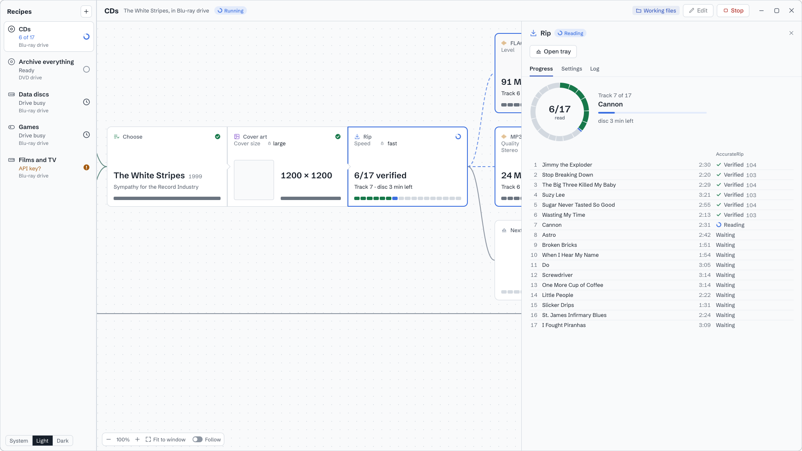
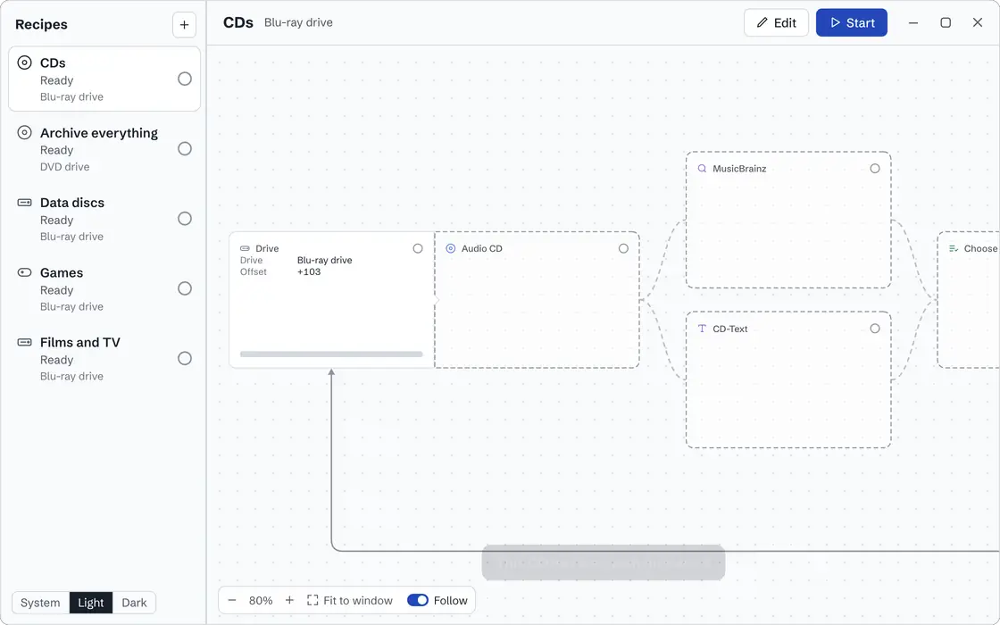
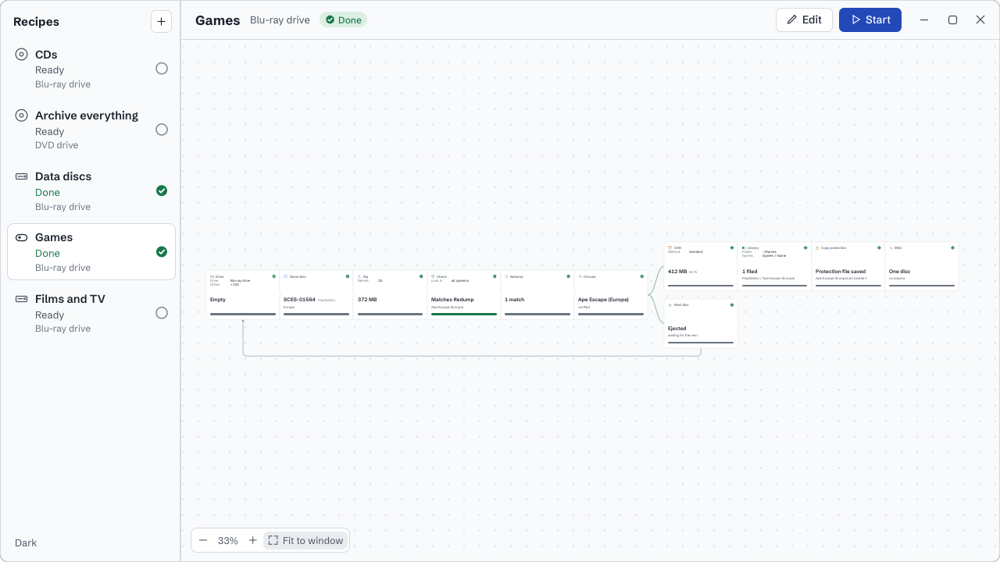
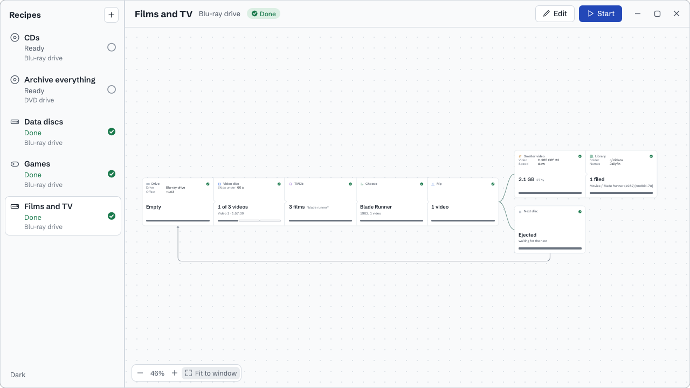

<div align="center">


# Disc Rip Trip

**Put a disc in, get properly named, checked files in your library.**

[](https://github.com/vresistor/disc-rip-trip/actions/workflows/build.yml)
[](LICENSE)

<a href="docs/screenshots/rip-running-light.png"><picture>
  <source media="(prefers-color-scheme: dark)" srcset="docs/screenshots/rip-running-dark.png">
  
</picture></a>

</div>

Disc Rip Trip rips audio CDs, data discs, PlayStation games, DVDs and
Blu-rays on Linux. It finds out what the disc is. It checks that what
it read is right. Then it files the results under the right names.

Each kind of disc goes through a **recipe**: a row of steps. You can
watch the steps while they run, and change them.

## See it run

<a href="docs/demo.webm"></a>

**A CD from start to finish** (simulated). Click it for the video.

<a href="docs/demo-retry.webm"></a>

**When a track doesn't match.** Click it for the video.

## Install

Linux, x86_64.

**The flatpak** is the easy way. Download `disc-rip-trip-*.flatpak`
from [Releases](https://github.com/vresistor/disc-rip-trip/releases),
then:

```sh
flatpak install --user ./disc-rip-trip-*.flatpak
```

It brings cyanrip, redumper, ffmpeg and ffprobe with it.

DVDs and Blu-rays also need [MakeMKV](https://www.makemkv.com). It's
never bundled, since it decrypts copy protection (see THIRD-PARTY.md). Get the Flathub flatpak
`com.makemkv.MakeMKV`, or get it from makemkv.com. Disc Rip Trip never
runs it until you say where it is: a recipe that reads video discs
waits at its Video disc and Rip steps, which list the MakeMKVs found on
your computer with **Use this**, or let you **Choose…** the program.
Only then is it run, once, to show its version. You can change or
revoke this under **MakeMKV** at the foot of the recipe list, where
there's also a switch, off unless you turn it on, to fetch MakeMKV's
free beta key from the MakeMKV forum when it runs out.

You can also [build it from source](#building-from-source). Then you
install the tools yourself.

**What the flatpak can reach.** It needs the disc drive, so it has
access to all devices. It can see your whole filesystem, so your
library can be on a network share, an external drive or anywhere else.
So the sandbox doesn't wall it off from the rest of your system. Treat
it like any program you install.

It can also start programs outside itself, which is how it runs MakeMKV
(on your system, or from MakeMKV's own flatpak). The app uses that only
for the MakeMKV you choose in it, and runs nothing until you have: for
video discs it lists the copies it found and lets you pick one, or
choose the file yourself. Nothing to set up beyond that.

## Your first CD

1. **Pick your drive.** The built-in recipes start out pointing at
   made-up drives, so their Drive step says *Not connected*. Click the
   Drive step in the *CDs* recipe and pick your drive. It then looks up
   the drive's read offset in AccurateRip's list.
2. **Check where the files go.** The *Library* steps at the end say
   which folder. Click one to change it.
3. **Put a CD in and press Start.**
4. **Answer if it asks.** *Choose* picks the album itself when the disc
   ID matches. When it isn't sure, it asks, with the best match picked.
5. **Let the files through.** The tracks wait in a *Review* folder
   first, so you can listen. Then click *Hold* and let them through
   into your library.

**Next disc** opens the tray when the rip is done. Put the next CD in
and it starts again, while the last one is still encoding.

To try it without a disc, start it with `--simulate`:

```sh
flatpak run io.github.vresistor.disc-rip-trip --simulate
```

It makes up two drives and a disc of every kind. It doesn't touch your
drives, the network or your files, and it keeps its own recipes and
settings.

## Recipes

- **A recipe is a row of steps**, read left to right: the drive, what
  kind of disc it is, the lookups, *Choose*, *Rip*, the encoders, the
  folders.
- **Every step shows how it's doing** while the disc goes through:
  *6 of 17*, *Which album is this?*, *2 encoding*.
- **Click a step to see it in the sidebar:** what it did, its settings,
  and its log. There's no separate settings page.
- **Follow**, at the bottom of the canvas, keeps the step that's working
  or waiting for you in view.
- **Add a step with +** while editing. It only offers steps that fit
  there, so you can't end up with a recipe that doesn't work.
- **Hold** keeps files in a review folder until you let them through.
- **Notify** tells you how the disc went, on your desktop or your phone
  (through ntfy).

<table>
<tr>
<td width="50%"><a href="docs/screenshots/choose-light.png"><picture><source media="(prefers-color-scheme: dark)" srcset="docs/screenshots/choose-dark.png"></picture></a><br><sub>Choose asks only when it isn't sure.</sub></td>
<td width="50%"><a href="docs/screenshots/edit-picker-light.png"><picture><source media="(prefers-color-scheme: dark)" srcset="docs/screenshots/edit-picker-dark.png"></picture></a><br><sub>Editing: + offers only what fits.</sub></td>
</tr>
</table>

The built-in recipes are *CDs*, *Data discs*, *Games*, *Films and TV*,
and *Archive everything* (four lookups and four outputs, to show what
a recipe can do). You can change any of them. *Reset to original* puts
one back.

### What each recipe does

| Disc | Reads with | Finds out what it is from | You get |
|---|---|---|---|
| Audio CD | cyanrip, checked against AccurateRip | MusicBrainz, CD-Text, Discogs, GnuDB | each track in the formats you pick (FLAC, MP3, Opus, AAC, ALAC, Vorbis, WavPack, WAV), tagged, with cover art and lyrics, and the album's scans beside them if you like |
| Data disc | redumper | Redump, by checksum | a checked disc image, as a CHD or as a plain image |
| PlayStation game | redumper | Redump, by checksum, else by serial | a verified CHD named for the exact release, with its LibCrypt `.sbi` and a `.m3u` for multi-disc games |
| DVD, Blu-ray | MakeMKV | TMDb | films and episodes, converted to H.265 or AV1 or kept as they are, named the way Jellyfin likes |

<table>
<tr>
<td width="33%"><a href="docs/screenshots/data-light.png"><picture><source media="(prefers-color-scheme: dark)" srcset="docs/screenshots/data-dark.png"></picture></a><br><sub>A data disc: ripped, checked, CHD, filed.</sub></td>
<td width="33%"><a href="docs/screenshots/games-light.png"><picture><source media="(prefers-color-scheme: dark)" srcset="docs/screenshots/games-dark.png"></picture></a><br><sub>A PlayStation game, checked against Redump.</sub></td>
<td width="33%"><a href="docs/screenshots/video-light.png"><picture><source media="(prefers-color-scheme: dark)" srcset="docs/screenshots/video-dark.png"></picture></a><br><sub>A film, found on TMDb and filed for Jellyfin.</sub></td>
</tr>
</table>

### How audio is checked

Each track is checked against AccurateRip. If it doesn't match, it's
read again carefully. If the reads still don't agree, the track waits
for you. You can pick *Read again*, *Best of 3 reads*, *Read again
slowly*, *Keep it anyway* or *Skip this track*. The rules are in
[`docs/audio-accuracy.md`](docs/audio-accuracy.md).

<a href="docs/screenshots/rip-sidebar-light.png"><picture><source media="(prefers-color-scheme: dark)" srcset="docs/screenshots/rip-sidebar-dark.png"></picture></a>

## Troubleshooting

- **A Drive step says *Not connected*.** The recipe points at a drive
  that isn't plugged in. Click the step and pick the drive you have.
- **A step says *Not available*.** This build doesn't have that step.
  Remove it, or use *Reset to original*.
- **The window says a tool is missing.** A build from source needs
  the tools in [Tools to install](#tools-to-install). The flatpak has
  all of them but MakeMKV.
- **The Drive step says *Read offset?*** Your drive isn't in
  AccurateRip's list. Put in a pressed CD that AccurateRip knows, click
  the Drive step and press *Measure offset*.
- **A track doesn't match.** See [How audio is checked](#how-audio-is-checked).
  A scratch, a dirty disc or a CD that AccurateRip doesn't know can all
  cause it.
- **Films and TV won't start.** It needs a free TMDb API key. Click the
  TMDb step and paste it in.
- **The drive's eject button does nothing.** See
  [Getting a disc out](#getting-a-disc-out).
- **A run stopped or failed.** Its working files are kept, so you can
  look at them (see [Where things are kept](#where-things-are-kept)).
  Each step's log is in its sidebar.

### Getting a disc out

While a disc is being read, Linux locks the drive's door, so the drive's
own eject button does nothing. Use **Open tray** instead: it's on the
Drive step's sidebar, and on Rip's while it reads. It stops the read
(the track waits for you, and nothing from the half-finished read is
kept), unlocks the door and opens the tray. Put the disc back and choose
**Read again** to go on.

If you'd rather the drive's button always worked, you can tell Linux not
to lock the door (needs root, and lasts until the next restart):

```sh
sudo sysctl dev.cdrom.lock=0
```

To keep it, put `dev.cdrom.lock = 0` in a file in `/etc/sysctl.d/`. The
catch: the button then pulls the disc out mid-read, without warning. The
read fails and that track waits for you, but nothing stops the press.

## Building from source

You need:

- Rust 1.89 or newer ([rustup](https://rustup.rs)),
- a C and C++20 compiler (`gcc-c++` on Fedora, `build-essential` on
  Ubuntu), for the built-in CHD library,
- a graphics driver with Vulkan or OpenGL. Mesa's is fine.

```sh
git clone https://github.com/vresistor/disc-rip-trip
cd disc-rip-trip
cargo build --release -p drt-app -p drt   # target/release/disc-rip-trip and drt
cargo run --release --bin disc-rip-trip -- --simulate  # made-up drives and discs, to try it out
```

There's also `drt`, which runs a recipe in the terminal:

```sh
cargo run --bin drt -- --simulate                           # the CDs recipe, simulated
cargo run --bin drt -- --recipe archive --simulate --bad 9  # track 9 fails to verify
cargo run --bin drt -- --help
```

Tests: `cargo test --workspace`. The window tests save a picture of
every state they reach to `app/shots/`.

To build the flatpak yourself, run `scripts/build-flatpak.sh` (add
`--install` to install it). It builds everything inside the GNOME SDK.
The first time, it fetches the SDK and the tools.

## Tools to install

A build from source runs these programs. It looks for each one on your
`PATH`. You can also point at one with `DRT_<NAME>`, for example
`DRT_CYANRIP=/opt/cyanrip/bin/cyanrip`. If one is missing, the window
says so at the top. The flatpak has all of them but MakeMKV.

| Tool | Needed for | Getting it |
|---|---|---|
| [cyanrip](https://github.com/cyanreg/cyanrip) | audio CDs, and measuring a drive's offset | Not in Fedora. Ubuntu 24.04 has 0.9.2; the app is tested with 0.9.3. Otherwise build it: `scripts/build-cyanrip.sh <folder>`. |
| [redumper](https://github.com/superg/redumper) | data discs and games | Download a build from its releases page. |
| [ffmpeg](https://ffmpeg.org) and ffprobe | every encoder, ReplayGain, converting and remuxing video | From your distro, with the encoders the recipes use (LAME, Opus, Vorbis, x265, SVT-AV1). Fedora's `ffmpeg-free` has no x265, so use RPM Fusion's. |
| [MakeMKV](https://www.makemkv.com) | DVDs and Blu-rays | The Flathub flatpak `com.makemkv.MakeMKV`, or makemkv.com. The app never bundles it. |

CHD files are made by MAME's CHD library, built into the app
([libchdman-rs](https://crates.io/crates/libchdman-rs)). There's no
`chdman` to install.

## Online services

Most need no account. You set a key or token once, in the step that
uses it, and every recipe shares it.

| Service | Used for | Key |
|---|---|---|
| [MusicBrainz](https://musicbrainz.org) | releases, by disc ID, and the other editions of the album chosen | none |
| [Cover Art Archive](https://coverartarchive.org) | the chosen release's cover (or a bigger one from another edition of the album), and its scans for Artwork files | none |
| [LRCLIB](https://lrclib.net) | lyrics, synced when it has them | none |
| [Discogs](https://www.discogs.com) | releases, by barcode, catalogue number, or artist and album | a personal access token (Discogs: Settings, Developers). Without one, the step is skipped. |
| [GnuDB](https://gnudb.org) | releases, by CDDB ID | your email address, which GnuDB asks for. Without one, the step is skipped. |
| [AccurateRip](http://www.accuraterip.com) | checking each track, and the list of drive offsets | none |
| [Redump](http://redump.org) | checking data discs and games | none. Its lists are kept for two weeks. Redump has no HTTPS, so they arrive unencrypted. At worst a changed list misnames a game; each disc is still checked against its own checksums. |
| [TMDb](https://www.themoviedb.org/settings/api) | films and series | a free API key. *Films and TV* can't start without one. |
| [ntfy](https://ntfy.sh) | Notify, on your phone | a topic name you choose. Uses `https://ntfy.sh` unless you set your own server. |

## Where things are kept

| What | Where |
|---|---|
| Recipes and settings | `~/.config/disc-rip-trip/` (`recipes.json`, `settings.json`). `--simulate` uses a `simulate/` folder inside it. |
| A run's working files | `~/.cache/disc-rip-trip/runs/`. Once everything a run made is filed, its folder is deleted (when the next disc replaces it, if the run still offers a retry). One stopped before anything was encoded goes once replaced, or at start-up after a day. One holding encoded files that were never filed (say the network share was down) is never deleted by itself: **Working files**, at the foot of the recipe list, lists it to open or delete. The small `runs/*.json` records stay. |
| Downloaded lists (drive offsets, Redump) | `~/.cache/disc-rip-trip/cache/` |

These follow `$XDG_CONFIG_HOME` and `$XDG_CACHE_HOME` if you set them.

The flatpak keeps them in `~/.var/app/io.github.vresistor.disc-rip-trip/`
(`config/disc-rip-trip/`, `cache/disc-rip-trip/`). The first time it
starts, if it has no recipes yet, it copies `recipes.json` and
`settings.json` from `~/.config/disc-rip-trip/`. So a build from source
and the flatpak start out the same.

If `recipes.json` or `settings.json` can't be read, the app never
overwrites it. It uses the built-in recipes and leaves your file alone.

## Status

- Every recipe runs. The CDs recipe has ripped real discs end to end.
- Data discs, games and video are built and tested on simulated discs,
  but not yet on real ones.
- Linux only. It doesn't build on Windows yet (running the tools needs
  a Unix pseudo-terminal), and on macOS it wouldn't find any drives. So
  there are no Windows or macOS downloads.

## More

- [`DESIGN-UX.md`](DESIGN-UX.md): how it's designed. Recipes, steps,
  what can follow what, the window.
- [`GLOSSARY.md`](GLOSSARY.md): the words it uses, and the ones it
  avoids.
- [`docs/audio-accuracy.md`](docs/audio-accuracy.md): offsets, reads
  and how each track is checked.
- [`docs/portability.md`](docs/portability.md): what it would take to
  run elsewhere.
- [`docs/adr/`](docs/adr/): decisions, and why.

## Licence

GPL-3.0-or-later. See [`LICENSE`](LICENSE).
[`THIRD-PARTY.md`](THIRD-PARTY.md) lists what a release bundles, under
which terms, and where its source is. MakeMKV is never bundled; that
file says why.
